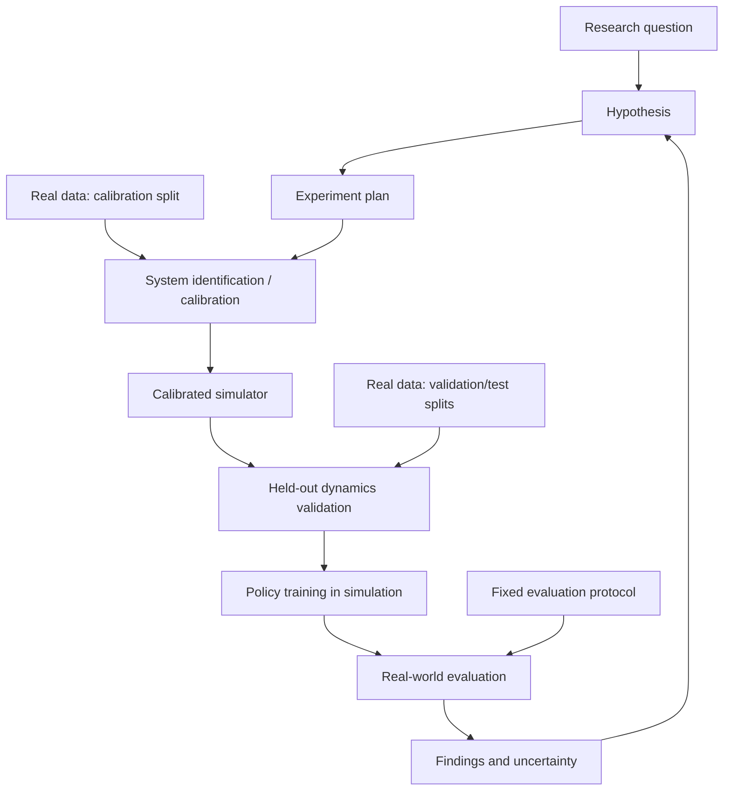

# Deformable Sim-to-Real Research Lab

> **Исследовательский репозиторий для калибровки симуляции деформируемых объектов по реальным данным и проверки того, улучшает ли такая калибровка перенос робототехнических политик из симуляции в реальность.**

**Статус:** проектирование исследовательской инфраструктуры. Наличие описанной ниже структуры не означает, что эксперименты уже проведены или что программные компоненты реализованы.

## 1. Исследовательская задача

Робототехнические политики, обученные в симуляции, часто теряют качество при работе с реальными деформируемыми объектами: тканью, верёвками, гибкими деталями и мягкими телами. Причина может заключаться в несовпадении динамики, контактов, трения, геометрии, наблюдений и управления между симулятором и реальной системой (*sim-to-real gap*).

**Главный исследовательский вопрос:** улучшает ли настройка модели симуляции по реальным наблюдениям деформируемых объектов качество *real-world task performance* относительно обучения в исходном симуляторе и других контрольных подходов?

Мы рассматриваем калибровку не как самоцель, а как проверяемый метод повышения качества обучения и переноса политик.

### Цели

1. Собирать и документировать реальные траектории взаимодействия робота с деформируемыми объектами.
2. Оценивать параметры и неопределённость модели симуляции по калибровочному набору реальных данных.
3. Проверять соответствие симуляции реальности на **отложенных** траекториях, не использованных при настройке.
4. Обучать/оценивать политики на сопоставимых условиях и сравнивать перенос на реального робота.
5. Сохранять все гипотезы, планы, версии кода, конфигурации, запуски и результаты как связанную исследовательскую историю.

### Что **не** предполагается заранее

- Что единственный оптимальный симулятор, модель материала или алгоритм калибровки уже известны.
- Что меньшее визуальное расхождение автоматически даёт лучшую робототехническую политику.
- Что все физические параметры идентифицируемы по доступным сенсорам.
- Что успех в симуляции сам по себе доказывает улучшение sim-to-real.

## 2. Научный цикл



**Ключевое правило:** данные, по которым подбирались параметры симулятора, не могут одновременно использоваться как независимое доказательство качества настройки. Для оценки переноса нужна отдельная, заранее заданная real-world evaluation процедура.

## 3. Основные исследовательские объекты

| Объект | ID | Где хранится | Назначение |
|---|---|---|---|
| Research question | `Q-0001` | `research/questions/` | Научный вопрос |
| Hypothesis | `H-0001` | `research/hypotheses/` | Проверяемое утверждение и критерий опровержения |
| Experiment | `E-0001` | `research/experiments/` + `experiments/` | Описание и исполняемый план |
| Baseline | `BL-0001` | `research/baselines/` + `registry/baselines/` | Контрольный метод / реализация |
| Benchmark | `B-0001` | `research/benchmarks/` + `registry/benchmarks/` | Набор задач и условий оценки |
| Protocol | `P-0001` | `research/protocols/` + `registry/protocols/` | Правила сравнения, метрики и сплиты |
| Run | `R-0001` | `runs/` | Зафиксированное исполнение с provenance |
| Run review | `RR-0001` | `research/run-reviews/` | Обзор значимого запуска со ссылкой на manifest |
| Finding | `F-0001` | `research/findings/` | Вывод с явными ссылками на evidence |

**Markdown** служит объяснимой научной памятью и основой графа Foam в VS Code. **YAML** в `registry/` и `experiments/` задаёт машинно-читаемые конфигурации. **Run manifests** описывают фактическое исполнение и не подменяются текстовыми заметками.

## 4. Планируемая структура репозитория

```text
.
├── README.md
├── AGENTS.md
├── pyproject.toml                 # после появления Python-пакета
├── .vscode/                      # настройки и рекомендованные расширения
├── .foam/                        # шаблоны Markdown-заметок
│
├── research/                     # знания; отображаются в Foam
│   ├── index.md
│   ├── questions/
│   ├── hypotheses/
│   ├── experiments/
│   ├── findings/
│   ├── baselines/
│   ├── benchmarks/
│   ├── protocols/
│   └── run-reviews/              # выборочные обзоры значимых запусков
│
├── registry/                     # версии исполняемых спецификаций
│   ├── baselines/
│   ├── benchmarks/
│   └── protocols/
├── experiments/                  # YAML-планы экспериментов
│
├── src/lab/
│   ├── core/                     # схемы, интерфейсы, идентификаторы
│   ├── adapters/
│   │   ├── simulators/           # интерфейсы движков физики
│   │   ├── policies/             # ACT, Diffusion Policy, etc.
│   │   └── benchmarks/           # адаптеры задач и сред
│   ├── data/                     # ingest, sync, coordinate frames, splits
│   ├── calibration/              # parameter fitting, objectives, uncertainty
│   ├── training/                 # обучение политик
│   ├── evaluation/               # runner, metrics, comparison
│   ├── knowledge/                # validation, index, wikilinks
│   └── cli.py
│
├── datasets/                     # манифесты и ссылки; не обязательно raw data
├── runs/                         # небольшие метаданные запусков
├── third_party/                  # опциональные Git submodules
├── environments/                 # воспроизводимые окружения / контейнеры
├── schemas/                      # JSON Schema / YAML validation
├── tests/
└── .github/workflows/            # проверки схем и smoke-tests
```

Каталоги — **целевой дизайн**, а не утверждение, что все файлы уже существуют. Не следует добавлять пустые слои только ради соответствия дереву.

## 5. Данные реальных деформируемых объектов

Поддерживаемые модальности определяются конкретным экспериментом:

- RGB/RGB-D / stereo, сегментации, маски, ключевые точки или реконструированная геометрия.
- Состояния робота: суставы, поза end-effector, команды и временные метки.
- Контактные измерения: force/torque, тактильные данные — если доступны.
- Метаданные объекта: геометрия, материал, состояние, идентификатор экземпляра.
- Калибровка камер, преобразования координат, единицы измерения и оценка погрешностей.

Для каждой записи обязательны происхождение, условия сбора, версии обработки, правила доступа и разделение данных по назначению. Первичные измерения **не изменяются**; производные представления создаются отдельно с указанием преобразований.

### Разделение данных

| Split | Использование | Запрет |
|---|---|---|
| Calibration | Подбор параметров симулятора | Нельзя считать независимой проверкой fidelity |
| Validation | Выбор метода, гиперпараметров и диагностика | Нельзя выдавать за окончательный результат |
| Held-out test | Финальная оценка динамики / обобщения | Нельзя использовать для повторной подгонки |
| Real-world policy evaluation | Проверка качества переноса на робота | Нельзя оптимизировать метод по скрытым результатам теста |

Разделение следует проводить на уровне **сессий, физических экземпляров объектов и/или условий**, а не только случайных кадров одной траектории. Выбор уровня разделения фиксируется в протоколе до оценки.

## 6. Калибровка симуляции

Типовой эксперимент может оценивать параметры, связанные с жёсткостью, демпфированием, трением, контактом, массой, геометрией, ограничениями и моделью деформации. Перечень параметров зависит от типа объекта и возможностей движка.

```text
real trajectories + metadata
             │
             ▼
  observation / state alignment
             │
             ▼
   parameter estimation (+ uncertainty)
             │
             ▼
       simulator configuration
             │
             ▼
  held-out dynamics evaluation
             │
             ▼
      policy training & transfer
```

При оптимизации необходимо сохранять: исходную параметризацию, функцию потерь, ограничения и priors, версию симулятора, начальные значения, seeds, бюджет вычислений, найденные параметры и диагностические ошибки. Если параметры неидентифицируемы, это должно быть записано как ограничение, а не скрыто выбором одного «лучшего» набора.

## 7. Baselines и benchmarks

Минимальное содержательное сравнение:

1. **Uncalibrated simulator** — исходные параметры движка.
2. **Manual / nominal calibration** — ручные или номинальные параметры, когда доступны.
3. **Domain randomization** — обучение на распределении параметров без предложенного механизма настройки по данным.
4. **Real-data calibrated simulator** — исследуемый метод.

Дополнительные baselines и опубликованные результаты добавляются только с указанием источника и статуса: `published`, `reproduced` или `internal`. Не следует смешивать числа из статьи с результатами собственных запусков.

**Пример структуры оценки:** одинаковая архитектура политики (если тестируется именно калибровка), сопоставимые тренировочные бюджеты, фиксированный протокол, несколько seeds и доверительные интервалы. Если меняется одновременно и симуляция, и модель политики, это отдельное экспериментальное сравнение.

### Метрики

- **Основная метрика:** успех реальной робототехнической задачи (*real-world task success rate*) по заранее определённому критерию.
- **Вторичные метрики:** успех в симуляции, ошибка траектории/формы, контактная ошибка, robustness, время выполнения, частота отказов и ограничения безопасности.
- Для геометрической ошибки применяются только метрики, осмысленные для доступных данных (например, ошибку отслеживаемых точек, Chamfer distance при согласованных облаках точек).
- Все агрегаты сопровождаются числом независимых запусков/эпизодов, seeds, разбросом и описанием способа оценки неопределённости.

## 8. Пример связанной исследовательской записи

`research/hypotheses/H-0001.md`:

```markdown
---
id: H-0001
type: hypothesis
status: proposed
---

# Data calibration improves cloth manipulation transfer

## Claim
Калибровка симуляции по реальным траекториям улучшает
успех манипуляции тканью на физическом роботе относительно
обучения с исходными параметрами симулятора.

## Tests
- [[E-0001]]

## Findings
Пока отсутствуют.
```

`research/experiments/E-0001.md` описывает научную мотивацию и ссылается на `[[H-0001]]`, `[[BL-0001]]`, `[[B-0001]]`, `[[P-0001]]`. Исполняемый план находится в `experiments/E-0001.yaml`, а результаты запуска — в `runs/R-....`.

**Правило:** единые ID, однозначные ссылки, версия протокола и связность `Hypothesis → Experiment → Run → Finding`. Не создавайте фиктивные findings или runs ради красивого графа.

## 9. Работа в VS Code с Foam

1. Откройте корень репозитория в VS Code.
2. Установите расширение [Foam](https://marketplace.visualstudio.com/items?itemName=foam.foam-vscode).
3. Создавайте Markdown-заметки в `research/` с уникальными именами (`H-0001.md`, `E-0001.md`) и ссылками `[[E-0001]]`.
4. Откройте командную палитру и выберите **Foam: Show Graph**.

Шаблоны в `.foam/templates/` покрывают все папки `research/`:

| Папка | Шаблон |
|---|---|
| `questions/` | [question.md](.foam/templates/question.md) |
| `hypotheses/` | [hypothesis.md](.foam/templates/hypothesis.md) |
| `experiments/` | [experiment.md](.foam/templates/experiment.md) |
| `findings/` | [finding.md](.foam/templates/finding.md) |
| `baselines/` | [baseline.md](.foam/templates/baseline.md) |
| `benchmarks/` | [benchmark.md](.foam/templates/benchmark.md) |
| `protocols/` | [protocol.md](.foam/templates/protocol.md) |
| `run-reviews/` | [run-review.md](.foam/templates/run-review.md) |

При создании заметки замените ID и ссылки-заготовки на реальные,
выберите соответствующую папку и сохраните файл под его ID.
Обзоры `RR-NNNN` ссылаются на реально выполненные запуски `R-NNNN`.

Foam визуализирует связи заметок. Типизированные отношения (`tests`, `supports`, `contradicts`, `evaluated_on`) должны также храниться в машиночитаемых спецификациях и проверяться индексатором. Для большого количества запусков в граф выводятся лишь научно значимые обзоры, а не каждый episode.

## 10. Воспроизводимость и результаты

Каждый реально выполненный run должен иметь неизменяемый manifest, содержащий по крайней мере:

- ID эксперимента, baseline, benchmark и протокола;
- Git commit проекта и версии / commits внешних зависимостей;
- хеши датасета, checkpoint и конфигурации симулятора;
- конфигурацию train/eval, seeds, окружение, версии библиотек;
- идентификатор оборудования/системы, если применимо, и координатные соглашения;
- метрики, единицы измерения, ошибки и ссылки на логи, видео, trajectories;
- статус выполнения, время и причину прерывания (если было).

Большие данные и модели лучше хранить во внешнем versioned artifact storage; в Git сохранять manifests и контрольные суммы. Ни один результат не должен появляться без трассируемого источника.

## 11. Порядок развития проекта

- **M0 — Research graph:** Markdown-сущности, шаблоны, IDs, проверка ссылок.
- **M1 — Real-data pipeline:** ingestion, синхронизация сенсоров, transforms, data splits.
- **M2 — Simulation calibration:** один объект, один симулятор, фиксированная функция ошибки, held-out validation.
- **M3 — Baseline evaluation:** uncalibrated vs calibrated; затем domain randomization.
- **M4 — Policy transfer:** обучение на контролируемых условиях и реальная оценка.
- **M5 — Agent workflows:** подготовка планов и сравнения результатов с обязательным review.

Конкретные задачи, объекты, сенсоры, симуляторы и политики задаются отдельными экспериментами; они не должны быть зашиты в архитектуру.

## 12. Для участников и AI-агентов

Реализован пилот [VI/MAP-калибровки PhysTwin](environments/README-vi.md) без рендеринга.
План: [E-0001](research/experiments/E-0001.md); результаты и ограничения:
[F-0001](research/findings/F-0001.md). Неопределённость физических параметров
и преимущество для sim-to-real этим пилотом не установлены.
Повтор со стартом posterior из prior: [E-0002](research/experiments/E-0002.md),
[результаты и execution commit](research/findings/F-0002.md).

Практический урок: [перенос PhysTwin в Newton своими руками](tutorials/phystwin_to_newton.ipynb).
Notebook содержит задания, проверки сил / динамики / градиентов, интерактивный
просмотр траекторий и подготовку экспорта графа PhysTwin.
[Запуск notebook в отдельном venv на хосте](environments/README.md#notebook-перенос-phystwin).
Это учебная проверка адаптера; результаты калибровки и sim-to-real не заявляются.

Читайте [`AGENTS.md`](AGENTS.md) перед изменениями. Агентам разрешается анализировать данные, готовить гипотезы и код, запускать разрешённые offline-проверки и предлагать эксперименты. Выполнение операций на физическом оборудовании требует явного разрешения человека и отдельного safety protocol.

**Критерий успеха проекта:** воспроизводимые данные показывают, в каких условиях калибровка по реальным наблюдениям улучшает (или не улучшает) перенос политики на реальные деформируемые объекты — с корректными сравнениями, оговорёнными ограничениями и сохранённой историей решений.
